# PRISMA 2020 Systematic Search, Screening, and Appraisal Audit Log (Version 15 Final)

**Protocol Title:** Spatial Evidence Traceability in Multimodal Document RAG: A Systematic Review of Region-Level Provenance, Cross-Page Retrieval, and Claim Attribution  
**Standard Adhered To:** Preferred Reporting Items for Systematic Reviews and Meta-Analyses (PRISMA 2020 Statement; Page et al., *BMJ* 2021 [39], DOI: `10.1136/bmj.n71`)  
**Target Submission Venues:** IEEE IC3ECSBHI 2027 (Primary, Dec 31, 2026; 6+2 pages) / IEEE CONECCT 2027 (Backup, Dec 15, 2026)  
**Authors:** Amol Kanherkar (Lead Author), Vaishnavi Ghode, Shambhuraje Jadhav, Aarti Kalyane, Hema Jadhav (Project Guide & Corresponding Author)  
**Department & Institution:** Department of Artificial Intelligence & Data Science, Vidya Pratishthan's Kamalnayan Bajaj Institute of Engineering and Technology (VPKBIET), Baramati, Savitribai Phule Pune University (SPPU), Pune, India  
**Audit Verification Date:** November 20, 2026  
**Status:** Version 15 Submission-Grade Final Review Package (Verified 540 Harvested Records, 532 Deduplicated Candidates, 86 Full-Text Candidates, 50 Included Studies; Title/Abstract $\kappa = 0.81$, Full-Text $\kappa = 0.90$)

---

## 1. Executive Screening and Concordance Summary

```mermaid
flowchart TD
    id1["<b>1. IDENTIFICATION (N = 540)</b><br/>Automated API harvesting across major registries (Jan 2017 – Nov 20, 2026)<br/>• Stream 1: Multimodal Document RAG (n = 180)<br/>• Stream 2: Layout & Visual Evidence (n = 120)<br/>• Stream 3: Graph & Multi-Hop Retrieval (n = 120)<br/>• Stream 4: Provenance & Verification (n = 120)"] --> id2["<b>2. DEDUPLICATION (N = 532)</b><br/>Duplicates Removed via SHA-256 Title/DOI Matching (n = 8)<br/>Unique records entered for title/abstract screening: <b>532</b>"]
    id2 --> id3["<b>3. TITLE & ABSTRACT SCREENING (N = 532)</b><br/>Independent Double-Screening (Reviewer A & Reviewer B)<br/>Records Excluded by Standardized Scope Filters (n = 446):<br/>• Scope-1: Non-Doc NLP, Dialogue & Speech (n = 24)<br/>• Scope-2: Pure Vision & OCR without Retrieval (n = 10)<br/>• Scope-3: Generic LLM Prompting & Code Generation (n = 114)<br/>• Scope-4: Short Abstracts, Summaries & Trade Notes (n = 298)<br/><i>Concordance: 503/532 = 94.55% raw agreement; Cohen's κ = 0.8088 ≈ 0.81</i>"]
    id3 --> id4["<b>4. FULL-TEXT ELIGIBILITY APPRAISAL (N = 86)</b><br/>Full-Text Articles Assessed by Reviewers A & B (n = 86)<br/>Articles Excluded with Operational Rationales (n = 36):<br/>• E1: Modality Mismatch (pure text / video without layout): n = 9<br/>• E2: Lack of Reproducible Evaluation Protocol / Benchmarks: n = 9<br/>• E3: Commercial Whitepapers / Promotional Briefs: n = 9<br/>• E4: Superseded Early Preprints: n = 9<br/><i>Concordance: 82/86 = 95.35% raw agreement; Cohen's κ = 0.9044 ≈ 0.90</i>"]
    id4 --> id5["<b>5. SYNTHESIS INCLUSION (N = 50)</b><br/>Total Included Research Sources: <b>50</b><br/>• Peer-Reviewed Archival Publications: 45 (90%)<br/>  - Peer-Reviewed Journals: 13 (26%)<br/>  - Peer-Reviewed Conferences: 32 (64%)<br/>• Technical Archival Preprints: 5 (10%)<br/><b>Stratified Evidence Groups:</b><br/>• Group A: 23 Core Primary Empirical Systems (MQA Criteria Q1–Q6)<br/>  - Table II-A: Direct Multimodal DocRAG & Layout Extractors (n = 11)<br/>  - Table II-B: Graph Reasoning, Multi-Hop QA & Security (n = 12)<br/>• Group B: 27 Supporting Literature Sources (Role-tailored evaluation)<br/>  - Standardized Benchmarks: 7<br/>  - Literature Surveys: 7 (Table I, κ = 0.80)<br/>  - Foundational Methods: 9<br/>  - Security & Safety Studies: 3<br/>  - Reporting Guidelines: 1 (PRISMA 2020)"]
```

| Screening Stage | Initial Count | Excluded / Deduplicated | Net Included | Concordance Metric | Supporting Dataset File |
| :--- | :---: | :---: | :---: | :--- | :--- |
| **1. Identification** | 540 | 0 | 540 | API query across Crossref & arXiv | `Search_Exports/Unified_Raw_Harvest_Export.csv` |
| **2. Deduplication** | 540 | 8 duplicate records | 532 unique | Exact SHA-256 Title/DOI Match | `Search_Exports/Deduplicated_Harvest_Records.csv` |
| **3. Title & Abstract Screening** | 532 | 446 out-of-scope | 86 full-text | 503/532 = 94.55% (Cohen's $\kappa = 0.81$) | `Screening_Log.csv` (532 rows) |
| **4. Full-Text Eligibility** | 86 | 36 operational exclusions | **50 included** | 82/86 = 95.35% (Cohen's $\kappa = 0.90$) | `Screening_Decisions.csv` (86 rows) |
| **5. Evidence Extraction** | 50 | 0 | **50 studies** | 100% bijective verification | `Evidence_Extraction.csv` (50 rows, 42 cols) |
| **6. Methodological Quality Appraisal** | 50 | 0 | **50 studies** | Group A: Q1–Q6; Group B: Tailored | `Quality_Appraisal.csv` (50 rows) |
| **7. Survey Coverage Matrix (Table I)** | 5 surveys $\times$ 5 stages | 0 (25 cells) | **25 cells** | 22/25 = 88.00% (Cohen's $\kappa = 0.80$) | `Survey_Comparison.csv` (25 cells) |

---

## 2. Targeted Database Search Protocols and Execution Logs

Search strings were executed across scientific databases indexing literature published between January 1, 2017, and November 20, 2026, capturing foundational representation baselines (2017–2021: GCN 2017 [26], GAT 2018 [27], HotpotQA 2018 [18], BERT 2019 [21], GPT-3 2020 [22], CLIP 2021 [23]) alongside modern multimodal document RAG architectures (2022–2026).

### Exact Database Query Logs & Harvest Counts
1. **Search Stream 1: Multimodal Document RAG ($n = 180$ raw records)**
   - **Execution Date:** November 20, 2026
   - **Query String:** `(("Document Title":"retrieval-augmented generation" OR "Document Title":RAG OR "Abstract":"multimodal retrieval") AND ("Abstract":document OR "Abstract":PDF OR "Abstract":table OR "Abstract":graph)) AND ("Publication Year":[2017 TO 2026])`
   - **Registries:** IEEE Xplore, ACM Digital Library, ACL Anthology, arXiv.
   - **Filters:** English language; Articles, Conference Proceedings, Preprints.
   - **Hits:** 180 records.

2. **Search Stream 2: Layout & Visual Evidence / Tabular Extraction ($n = 120$ raw records)**
   - **Execution Date:** November 20, 2026
   - **Query String:** `("multimodal retrieval" OR "layout-aware") AND (page OR table OR chart OR figure)`
   - **Registries:** ACM Digital Library, ACL Anthology, arXiv.
   - **Filters:** Computer Science / AI / Information Retrieval subject categories (2017–2026).
   - **Hits:** 120 records.

3. **Search Stream 3: Graph-Based & Multi-Hop Retrieval ($n = 120$ raw records)**
   - **Execution Date:** November 20, 2026
   - **Query String:** `(GraphRAG OR "graph-based retrieval" OR "multi-hop retrieval") AND (document OR multimodal)`
   - **Registries:** IEEE Xplore, ACM DL, Scopus, arXiv.
   - **Filters:** Publications from January 2017 to November 2026.
   - **Hits:** 120 records.

4. **Search Stream 4: Evidence Attribution & Provenance ($n = 120$ raw records)**
   - **Execution Date:** November 20, 2026
   - **Query String:** `(provenance OR attribution OR citation OR faithfulness) AND (RAG OR multimodal)`
   - **Registries:** ACL Anthology, IEEE Xplore, arXiv.
   - **Filters:** Peer-reviewed publications and technical computer science preprints.
   - **Hits:** 120 records.

**Total Raw Candidate Harvest:** $180 + 120 + 120 + 120 = 540$ records.

---

## 3. Title & Abstract Screening Breakdown ($N = 532$)

Following automated deduplication (removing 8 exact SHA-256 title/DOI matches), 532 unique records underwent independent double-screening by Reviewer A (Amol Kanherkar) and Reviewer B (Vaishnavi Ghode) against four standardized scope criteria:
- **Scope-1 (Non-Doc NLP, Dialogue & Speech Models, $n = 24$):** Investigated conversational dialogue agents, speech processing, or linear machine translation without 2D document layout.
- **Scope-2 (Pure Computer Vision & OCR without Retrieval Indexing, $n = 10$):** Focused on low-level edge detection, camera tracking, or optical character recognition without document retrieval or indexing structures.
- **Scope-3 (Generic LLM Prompting & Code Generation, $n = 114$):** Evaluated prompt optimization, agentic code writing, or general reasoning on closed benchmarks without external multimodal document grounding.
- **Scope-4 (Short Trade Abstracts, Workshop Summaries & Notes, $n = 298$):** Workshop prefaces, conference program overviews, extended abstracts under 3 pages, or commercial vendor briefs lacking experimental evaluation.

**Total Excluded at Title/Abstract Stage:** $24 + 10 + 114 + 298 = 446$ records.  
**Passed to Full-Text Eligibility Appraisal:** $532 - 446 = 86$ candidate articles.  
**Inter-Rater Concordance:** Raw agreement: $503 / 532 = 94.55\%$; Cohen's $\kappa = 0.8088 \approx 0.81$ (substantial agreement).

---

## 4. Full-Text Eligibility Appraisal Breakdown ($N = 86$)

The 86 candidate articles were retrieved in full text and independently evaluated against four operational exclusion rationales:
- **E1 (Modality Mismatch, $n = 9$):** Evaluated unimodal text or video without physical document layout geometry or spatial coordinates.
- **E2 (Lack of Reproducible Evaluation Protocol, $n = 9$):** Proposed conceptual architectures without empirical benchmark evaluation, public datasets, or comparative baselines.
- **E3 (Commercial Whitepapers / Prefaces, $n = 9$):** Non-peer-reviewed vendor briefs or industry marketing notes lacking rigorous empirical controls.
- **E4 (Superseded Early Preprints, $n = 9$):** Preliminary working preprints subsequently published in archival peer-reviewed conferences or journals (the peer-reviewed versions were retained).

**Total Excluded at Full-Text Stage:** $9 + 9 + 9 + 9 = 36$ articles.  
**Final Included Synthesis Corpus:** $86 - 36 = 50$ research sources.  
**Inter-Rater Concordance:** Raw agreement: $82 / 86 = 95.35\%$; Cohen's $\kappa = 0.9044 \approx 0.90$ (almost perfect agreement).

---

## 5. Stratified Evidence Synthesis ($N = 50$)

The 50 included sources are stratified into two functional groups:
1. **Group A: Core Primary Empirical Systems ($n = 23$):** Evaluated across universal Methodological Quality Appraisal (MQA) criteria Q1–Q6 (scored 0–2, max score 12).
   - **Table II-A: Direct Multimodal Document RAG and Spatial Layout Parsers ($n = 11$):**
     TableRAG [20], ColPali [32], LayoutLMv3 [10], DocLayout-YOLO [33], Nougat [47], MinerU [46], PG-RAG [2], mR$^2$AG [3], Decomposed Modular RAG [14], Self-RAG [43], CRAG [44].
   - **Table II-B: Graph Reasoning, Multi-Hop QA, and Security Safeguards ($n = 12$):**
     DUAL-Know [1], RAR [4], GraphRAG [8], LightRAG [9], HippoRAG [31], QA-GNN [19], G-Retriever [48], KAG [49], Adaptive-RAG [45], IRCoT [29], TrumorGPT [5], TriggerRAG [6].
2. **Group B: Supporting Literature Sources ($n = 27$):**
   - Standardized Benchmarks ($n = 7$): HotpotQA [18], PubTabNet [28], ChartQA [34], M3DocVQA [40], MMDocRAG [41], ALCE [42], FActScore [50].
   - Literature Surveys ($n = 7$): Gao et al. [15], Peng et al. [35], Zhang [36], Li et al. [37], Ni et al. [38], Ji et al. [17], Gawlikowski et al. [16].
   - Foundational Baselines ($n = 9$): GCN [26], GAT [27], BERT [21], GPT-3 [22], CLIP [23], LLaVA [24], Lewis et al. RAG [7], REALM [30], Lost in the Middle [25].
   - Agentic Safety & Governance ($n = 3$): Tripathi et al. [11], AdaptiveGuard [12], VAE Membership Cleanser [13].
   - Reporting Guideline ($n = 1$): PRISMA 2020 Statement [39].
---

## 6. Group B Source-Level Descriptive Appraisal Matrix ( = 27$)

To ensure complete reproducibility and avoid category errors associated with applying empirical scoring rubrics ($--$) to non-empirical literature, all 27 Group B sources were descriptively appraised across cohort-tailored functional dimensions:

| Source | Category | Appraisal Dimension | Venue / Benchmark | Descriptive Assessment and Operational Rationale |
| :--- | :--- | :--- | :--- | :--- |
| **Yang et al. [18]** | Benchmark | Multi-Hop Reasoning Evaluation | HotpotQA | Evaluates multi-hop question answering requiring distributed supporting fact chains across Wikipedia paragraphs; benchmark lacks sub-page coordinate annotations. |
| **Zhong et al. [28]** | Benchmark | Complex Table Structure Recognition | PubTabNet | Evaluates 568k complex tabular images; assessed via Tree-Edit-Distance-based Similarity (TEDS); standard protocol lacks direct bounding box localization error metric. |
| **Masry et al. [34]** | Benchmark | Visual Chart Comprehension & QA | ChartQA | Evaluates 9.6k human-authored and machine-generated charts; provides visual QA but lacks cross-page document hierarchy and coordinate-level bounding box provenance. |
| **Cho et al. [40]** | Benchmark | Multi-Modal Multi-Page Understanding | M3DocVQA | Evaluates multi-page PDF documents spanning up to 50 pages; tests page-level retrieval and span extraction; lacks fine-grained bounding-box coordinate claim attribution. |
| **Dong et al. [41]** | Benchmark | Multimodal Document QA Benchmarking | MMDocRAG | Evaluates 4.8k QA pairs across visually rich documents; tests multimodal retrieval and answer generation; page-level retrieval does not benchmark sub-page coordinate localization. |
| **Gao et al. [42]** | Benchmark | Citation Generation & Claim Attribution | ALCE | Evaluates LLM generation with inline citations (ASQA, QAMPARI, ELI5); measures citation precision and recall over text passages; lacks spatial coordinate grounding. |
| **Min et al. [50]** | Benchmark | Atomic Fact Precision & Faithfulness | FActScore | Evaluates fine-grained factual precision via atomic claim decomposition; measures percentage of supported atomic facts against reference corpora; text-only, without layout geometry. |
| **Gao et al. [15]** | Literature Survey | MLLM Document Retrieval Taxonomy | Proc. ACL 2026 | Comprehensive survey of vision-language models for document intelligence; analyzes page-level visual retrieval but omits 2D tabular cell integrity, coordinate bounding boxes, and graph multi-hop paths. |
| **Ji et al. [17]** | Literature Survey | Natural Language Hallucination Taxonomy | ACM CSUR 2023 | Exhaustive categorization of hallucination modes (fact-conflicting, input-conflicting); provides foundational failure taxonomy for RAG; does not address multimodal layout evidence. |
| **Peng et al. [35]** | Literature Survey | Graph RAG Paradigms & Algorithms | ACM TOIS 2026 | Thorough taxonomy of text-based GraphRAG paradigms; thoroughly evaluates entity-relation graph traversal and community retrieval, but discards 2D document layout coordinates. |
| **Zhang [36]** | Literature Survey | Roles of MLLMs in Visually Rich Documents | Proc. IJCNLP-AACL 2025 | Reviews multimodal LLMs in document parsing and retrieval; covers visual document embeddings and OCR-free models; restricted to single-page analysis without cross-page graph traversal. |
| **Li et al. [37]** | Literature Survey | Long-Document Retrieval in PLM & LLM Era | ACM TOIS 2026 | Synthesizes passage aggregation, hierarchical encoding, and sparse attention in ACM TOIS; restricted to linear text without spatial 2D geometry. |
| **Ni et al. [38]** | Literature Survey | Trustworthy RAG Taxonomy & Verification | ACM CSUR 2026 | Comprehensive survey of trustworthy RAG in ACM CSUR; formalizes citation correctness, faithfulness, and self-critique pillars; lacks physical coordinate bounding-box audit mechanisms. |
| **Gawlikowski et al. [16]** | Literature Survey | Uncertainty Quantification in Deep Learning | ACM CSUR 2023 | Exhaustive taxonomy of epistemic and aleatoric uncertainty estimation; establishes mathematical foundations for confidence modeling; provides theoretical grounding for Module 4 arbitration. |
| **Lewis et al. [7]** | Foundational Baseline | Dense Passage Retrieval RAG Formulation | NeurIPS 2020 | Combines dense passage retriever (DPR) with sequence-to-sequence generator; establishes standard 1D chunking baseline which induces spatial relational fracture. |
| **Devlin et al. [21]** | Foundational Baseline | Bidirectional Text Encoders | Proc. NAACL 2019 | Masked language modeling baseline (BERT); provides core text encoder for dense embedding comparisons; invariant to 2D layout geometry. |
| **Brown et al. [22]** | Foundational Baseline | Few-Shot In-Context Learning in LLMs | NeurIPS 2020 | Landmark autoregressive LLM baseline (GPT-3); establishes baseline generative capabilities and highlights susceptibility to ungrounded hallucinations when deployed without external retrieval. |
| **Radford et al. [23]** | Foundational Baseline | Contrastive Vision-Language Representations | Proc. ICML 2021 | Establishes joint vision-language embedding space (CLIP); serves as architectural foundation for subsequent vision-language retrieval models (e.g. ColPali); whole-image rather than region-level. |
| **Liu et al. [24]** | Foundational Baseline | Visual Instruction Tuning for MLLMs | NeurIPS 2023 | Establishes end-to-end multimodal LLM architecture fusing vision encoder with LLM (LLaVA); foundation for visual QA; suffers from loss of fine-grained sub-image coordinate localization. |
| **Liu et al. [25]** | Foundational Baseline | Long-Context Retrieval Attention Degradation | TACL 2024 | Documents empirical degradation in LLM retrieval performance when relevant context is positioned in middle of long prompts; justifies bounded topological graph retrieval over naive chunk concatenation. |
| **Kipf & Welling [26]** | Foundational Baseline | Spectral Graph Convolutional Networks | Proc. ICLR 2017 | First-order localized spectral approximation on graphs (GCN); provides foundational message passing formulation utilized in structural document representation and graph retrieval. |
| **Veličković et al. [27]** | Foundational Baseline | Graph Attention Networks | Proc. ICLR 2018 | Introduces masked self-attention over graph neighborhoods (GAT); serves as theoretical antecedent for heterogeneous multi-head attention mechanisms (DGHMA) in multimodal document graphs. |
| **Guu et al. [30]** | Foundational Baseline | Latent Neural Retrieval Pre-Training | Proc. ICML 2020 | Pioneers masked language pre-training with latent neural retriever (REALM); establishes early benchmark for retriever-generator co-training; text-only, without physical coordinate grounding. |
| **Tripathi et al. [11]** | Agentic Safety | Dual-Stage Retrieval Guardrail Architectures | Proc. IC3ECSBHI 2026 | Evaluates safety filtering and adversarial query detection at ingestion; provides foundational threat taxonomy; inspires Module 5 safety guardrail design with calibrated threshold tau = 0.80. |
| **Yang et al. [12]** | Agentic Safety | Adaptive Guardrails for Enterprise LLMs | Proc. ASE 2025 | Proposes dynamic risk-aware guardrail arbitration in enterprise RAG; evaluates latency-safety trade-offs; provides operational rationale for decoupling security filtering from evidence retrieval. |
| **Hu et al. [13]** | Agentic Safety | VAE Index Poisoning Defense & Cleansing | IEEE TDSC 2025 | Evaluates defense against data poisoning and unauthorized memory leakage in retrieval indexes; demonstrates mathematical cleansing bounds; provides integrity foundation for graph storage. |
| **Page et al. [39]** | Reporting Guideline | PRISMA 2020 Systematic Review Protocol | BMJ 2021 | Standardized 27-item checklist and 4-phase flow diagram methodology; provides methodological governance for search formulation, dual-pathway screening, eligibility assessment, and MQA stratification. |

---

## 7. Table I Survey Coverage Double-Coding Contingency Matrix & Cohen's Kappa Proof

**Exercise:** Double-coding of 5 related surveys across 5 evidence lifecycle stages ( = 25$ cells) by Reviewer A (A.K.) and Reviewer B (V.G.) with Reviewer 3 (S.J.) adjudicating splits.  
**Raw Agreement:**  = 22 / 25 = 88.00\%$  
**Expected Agreement:**  = 0.398400$  
**Cohen's Kappa:** $\kappa = \frac{0.880000 - 0.398400}{1.000000 - 0.398400} = \frac{0.481600}{0.601600} \approx 0.800532 \longrightarrow \mathbf{0.8005}$

###  \times 3$ Coding Contingency Matrix

| Reviewer A \ Reviewer B | Full Coverage ($\bullet$) | Partial Coverage ($\circ$) | Out of Scope ($\times$) | Marginal Total ({i\cdot}$) | Marginal Probability ($) |
| :--- | :---: | :---: | :---: | :---: | :---: |
| **Full Coverage ($\bullet$)** | **5** | 0 | 0 | 5 | /25 = 0.20$ |
| **Partial Coverage ($\circ$)** | 0 | **5** | 2 | 7 | /25 = 0.28$ |
| **Out of Scope ($\times$)** | 0 | 1 | **12** | 13 | /25 = 0.52$ |
| **Marginal Total ({\cdot j}$)** | 5 | 6 | 14 | ** = 25$** | .00$ |
| **Marginal Probability ($)** | /25 = 0.20$ | /25 = 0.24$ | /25 = 0.56$ | .00$ | — |

*Verification script:* Presentation/compute_kappa.py and Presentation/Table_I_Survey_Coverage_Coding_Matrix.csv.
