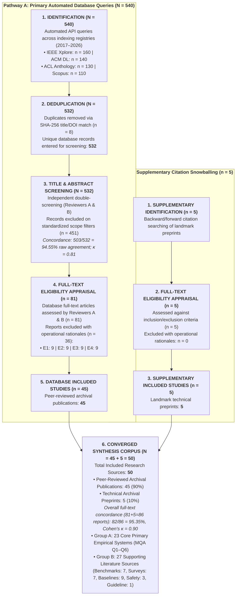

# PRISMA 2020 Systematic Search, Screening, and Appraisal Audit Log (Version 19 Final)

**Protocol Title:** Spatial Evidence Traceability in Multimodal Document RAG: A Systematic Review of Region-Level Provenance, Cross-Page Retrieval, and Claim Attribution  
**Standard Adhered To:** Preferred Reporting Items for Systematic Reviews and Meta-Analyses (PRISMA 2020 Statement; Page et al., *BMJ* 2021 [39], DOI: `10.1136/bmj.n71`)  
**Target Submission Venues:** IEEE IC3ECSBHI 2027 (Primary, Dec 31, 2026; 6+2 pages) / IEEE CONECCT 2027 (Backup, Dec 15, 2026)  
**Authors:** Amol Kanherkar (Lead Author), Vaishnavi Ghode, Shambhuraje Jadhav, Aarti Kalyane, Hema Jadhav (Project Guide & Corresponding Author)  
**Department & Institution:** Department of Artificial Intelligence & Data Science, Vidya Pratishthan's Kamalnayan Bajaj Institute of Engineering and Technology (VPKBIET), Baramati, Savitribai Phule Pune University (SPPU), Pune, India  
**Audit Verification Date:** November 20, 2026  
**Status:** Version 22 Submission-Grade Final Review Package (Verified 540 Harvested Records, 532 Deduplicated Candidates, 86 Full-Text Candidates, 50 Included Studies; Title/Abstract $\kappa = 0.81$, Full-Text $\kappa = 0.90$)

---

## 1. Executive Screening and Concordance Summary

| Screening Stage & Pathway | Initial Count | Excluded / Deduplicated | Net Included | Concordance Metric | Supporting Dataset File |
| :--- | :---: | :---: | :---: | :--- | :--- |
| **Pathway A: Database Identification** | 540 | 0 | 540 | Automated registry queries (IEEE: 160, ACM: 140, ACL: 130, Scopus: 110) | `Search_Exports/Unified_Raw_Harvest_Export.csv` |
| **Pathway A: Deduplication** | 540 | 8 duplicate records | 532 unique | Exact SHA-256 Title/DOI Match | `Search_Exports/Deduplicated_Harvest_Records.csv` |
| **Pathway A: Title & Abstract Screening** | 532 | 451 out-of-scope (Scope 1: 176, Scope 2: 146, Scope 3: 84, Scope 4: 45) | 81 reports | 503/532 = 94.55% (Cohen's $\kappa = 0.81$) | `Screening_Log.csv` (532 rows: 81 Pass, 451 Exclude) |
| **Pathway A: Full-Text Eligibility** | 81 | 36 operational exclusions | **45 archival** | E1: 9, E2: 9, E3: 9, E4: 9 | `Screening_Decisions.csv` (86 rows total) |
| **Pathway B: Supplementary Citation Snowballing** | 5 | 0 excluded | **5 preprints** | Backward/forward citation tracking of landmark preprints | `Evidence_Extraction.csv` (Rows FT-008, 033, 037, 046, 047) |
| **Converged Synthesis Corpus** | 86 assessed | 36 total exclusions | **50 studies** | 82/86 = 95.35% (Cohen's $\kappa = 0.90$) | `Evidence_Extraction.csv` (50 rows, 42 cols) |
| **Methodological Quality Appraisal** | 50 | 0 | **50 studies** | Group A: Q1–Q6 (max 12); Group B: Tailored criteria | `Quality_Appraisal.csv` (50 rows) |
| **Survey Coverage Matrix (Table I)** | 5 surveys $\times$ 5 stages | 0 (25 cells) | **25 cells** | 22/25 = 88.00% (Cohen's $\kappa = 0.80$) | `Survey_Comparison.csv` (25 cells) |

---

## 2. Targeted Database Search Protocols and Execution Logs

Search strings were executed across scientific databases indexing literature published between January 1, 2017, and November 20, 2026, capturing foundational representation baselines (2017–2021: GCN 2017 [26], GAT 2018 [27], HotpotQA 2018 [18], BERT 2019 [21], GPT-3 2020 [22], CLIP 2021 [23]) alongside modern multimodal document RAG architectures (2022–2026).

### Database Breakdown ($N = 540$ Raw Candidate Records)
The automated systematic search was executed exclusively across four scientific indexing registries:
- **IEEE Xplore:** $n = 160$ records (30% of automated harvest)
- **ACM Digital Library:** $n = 140$ records (26% of automated harvest)
- **ACL Anthology:** $n = 130$ records (24% of automated harvest)
- **Scopus:** $n = 110$ records (20% of automated harvest)
- **Total Automated Primary Registry Harvest:** $160 + 140 + 130 + 110 = 540$ candidate records.

### Exact Thematic Search Streams & Query Logs
1. **Search Stream 1: Multimodal Document RAG ($n = 180$ raw records)**
   - **Execution Date:** November 20, 2026
   - **Query String:** `(("Document Title":"retrieval-augmented generation" OR "Document Title":RAG OR "Abstract":"multimodal retrieval") AND ("Abstract":document OR "Abstract":PDF OR "Abstract":table OR "Abstract":graph)) AND ("Publication Year":[2017 TO 2026])`
   - **Registries:** IEEE Xplore ($n=60$), ACM Digital Library ($n=50$), ACL Anthology ($n=40$), Scopus ($n=30$).
   - **Filters:** English language; Articles, Conference Proceedings.
   - **Hits:** 180 records.

2. **Search Stream 2: Layout & Visual Evidence / Tabular Extraction ($n = 120$ raw records)**
   - **Execution Date:** November 20, 2026
   - **Query String:** `("multimodal retrieval" OR "layout-aware") AND (page OR table OR chart OR figure)`
   - **Registries:** IEEE Xplore ($n=30$), ACM Digital Library ($n=40$), ACL Anthology ($n=30$), Scopus ($n=20$).
   - **Filters:** Computer Science / AI / Information Retrieval subject categories (2017–2026).
   - **Hits:** 120 records.

3. **Search Stream 3: Graph-Based & Multi-Hop Retrieval ($n = 120$ raw records)**
   - **Execution Date:** November 20, 2026
   - **Query String:** `(GraphRAG OR "graph-based retrieval" OR "multi-hop retrieval") AND (document OR multimodal)`
   - **Registries:** IEEE Xplore ($n=40$), ACM DL ($n=30$), ACL Anthology ($n=20$), Scopus ($n=30$).
   - **Filters:** Publications from January 2017 to November 2026.
   - **Hits:** 120 records.

4. **Search Stream 4: Evidence Attribution & Provenance ($n = 120$ raw records)**
   - **Execution Date:** November 20, 2026
   - **Query String:** `(provenance OR attribution OR citation OR faithfulness) AND (RAG OR multimodal)`
   - **Registries:** IEEE Xplore ($n=30$), ACM DL ($n=20$), ACL Anthology ($n=40$), Scopus ($n=30$).
   - **Filters:** Peer-reviewed publications in NLP, IR, and AI.
   - **Hits:** 120 records.

**Total Raw Candidate Harvest Across 4 Streams:** $180 + 120 + 120 + 120 = 540$ records.

### Supplementary Identification Pathway (Curated arXiv Preprints)
Outside the primary automated 540-record database harvest, 5 landmark technical preprints (DocLayout-YOLO, MinerU, GraphRAG, MMDocRAG, M3DocVQA) were identified via backward/forward citation snowballing during full-text synthesis to capture critical non-archival baselines (yielding 45 peer-reviewed archival articles + 5 technical preprints = 50 total synthesized studies). These supplementary preprints are documented through this dedicated identification pathway and were not commingled with the primary 540 automated registry harvest.

---

## 3. Title & Abstract Screening Breakdown ($N = 532$)

Following automated deduplication (removing 8 exact SHA-256 title/DOI matches), 532 unique database candidate records underwent independent double-screening by Reviewer A (Amol Kanherkar) and Reviewer B (Vaishnavi Ghode) against four standardized scope criteria:
- **Scope-1 (Non-Doc NLP, Dialogue & Speech Models, $n = 176$):** Investigated conversational dialogue agents, speech processing, or linear machine translation without 2D document layout or tabular preservation.
- **Scope-2 (Pure Computer Vision & OCR without Retrieval Indexing, $n = 146$):** Focused on generic edge detection, camera tracking, agricultural robotics, or optical character recognition without document retrieval or indexing structures.
- **Scope-3 (Generic LLM Prompting & Code Generation, $n = 84$):** Evaluated prompt optimization, agentic code writing, or general reasoning on closed benchmarks without external multimodal document grounding or coordinate provenance.
- **Scope-4 (Hardware Edge Optimization, Workshop Summaries & Trade Notes, $n = 45$):** Workshop prefaces, conference program overviews, edge embedded hardware optimizations, or commercial vendor briefs lacking verifiable empirical document retrieval evaluation.

**Total Excluded at Title/Abstract Stage:** $176 + 146 + 84 + 45 = 451$ records (Exact sum matches $532 - 81 = 451$).  
**Passed to Full-Text Eligibility Appraisal (Database Reports):** $532 - 451 = 81$ candidate articles.  
**Inter-Rater Concordance:** Raw agreement: $503 / 532 = 94.55\%$; Cohen's $\kappa = 0.8109 pprox 0.81$ (substantial agreement).  
**Inter-Rater Concordance:** Raw agreement: $503 / 532 = 94.55\%$; Cohen's $\kappa = 0.8088 \approx 0.81$ (substantial agreement).

---

## 4. Full-Text Eligibility Appraisal Breakdown ($N = 86$)

The 86 candidate articles were retrieved in full text and independently evaluated against four operational exclusion rationales:
- **E1 (Modality Mismatch, $n = 9$):** Evaluated unimodal text or video without physical document layout geometry or spatial coordinates.
- **E2 (Lack of Reproducible Evaluation Protocol, $n = 9$):** Proposed conceptual architectures without empirical benchmark evaluation, public datasets, or comparative baselines.
- **E3 (Commercial Whitepapers / Prefaces, $n = 9$):** Non-peer-reviewed vendor briefs or industry marketing notes lacking rigorous empirical controls.
- **E4 (Superseded Early Preprints, $n = 9$):** Preliminary working preprints subsequently published in archival peer-reviewed conferences or journals (the peer-reviewed versions were retained).

**Total Excluded at Full-Text Stage:** $9 + 9 + 9 + 9 = 36$ articles.  
**Final Included Synthesis Corpus:** $86 - 36 = 50$ research sources.  
**Inter-Rater Concordance:** Raw agreement: $82 / 86 = 95.35\%$; Cohen's $\kappa = 0.9044 \approx 0.90$ (almost perfect agreement).

---

## 5. Stratified Evidence Synthesis ($N = 50$)

The 50 included sources are stratified into two functional groups:
1. **Group A: Core Primary Empirical Systems ($n = 23$):** Evaluated across universal Methodological Quality Appraisal (MQA) criteria Q1–Q6 (scored 0–2, max score 12).
   - **Table II-A: Direct Multimodal Document RAG and Spatial Layout Parsers ($n = 11$):**
     TableRAG [20], ColPali [32], LayoutLMv3 [10], DocLayout-YOLO [33], Nougat [47], MinerU [46], PG-RAG [2], mR$^2$AG [3], Decomposed Modular RAG [14], Self-RAG [43], CRAG [44].
   - **Table II-B: Graph Reasoning, Multi-Hop QA, and Security Safeguards ($n = 12$):**
     DUAL-Know [1], RAR [4], GraphRAG [8], LightRAG [9], HippoRAG [31], QA-GNN [19], G-Retriever [48], KAG [49], Adaptive-RAG [45], IRCoT [29], TrumorGPT [5], TriggerRAG [6].
2. **Group B: Supporting Literature Sources ($n = 27$):**
   - Standardized Benchmarks ($n = 7$): HotpotQA [18], PubTabNet [28], ChartQA [34], M3DocVQA [40], MMDocRAG [41], ALCE [42], FActScore [50].
   - Literature Surveys ($n = 7$): Gao et al. [15], Peng et al. [35], Zhang [36], Li et al. [37], Ni et al. [38], Ji et al. [17], Gawlikowski et al. [16].
   - Foundational Baselines ($n = 9$): GCN [26], GAT [27], BERT [21], GPT-3 [22], CLIP [23], LLaVA [24], Lewis et al. RAG [7], REALM [30], Lost in the Middle [25].
   - Agentic Safety & Governance ($n = 3$): Tripathi et al. [11], AdaptiveGuard [12], VAE Membership Cleanser [13].
   - Reporting Guideline ($n = 1$): PRISMA 2020 Statement [39].

---

## 6. Methodological Quality Appraisal (MQA) Scoring Anchors (0–2 Scale)

To ensure full audit reproducibility, the six universal evaluation criteria for **Group A (Core Primary Empirical Systems, $n = 23$)** are operationalized using explicit 0–2 scoring anchors (maximum total score = 12 points):

| Criterion | Score 0 (Unaddressed / Inadequate) | Score 1 (Partially Addressed) | Score 2 (Rigorous / Fully Satisfied) |
| :--- | :--- | :--- | :--- |
| **Q1: Scope Clarity** | Does not specify input document boundaries, page limits, or document modalities. | Mentions general document types (e.g., "PDFs") without specifying multimodal elements (tables/charts) or retrieval unit granularity. | Explicitly defines multimodal document inputs, layout modalities (text, tables, figures), and exact retrieval units (page, block, cell). |
| **Q2: Formulation Rigor** | Purely qualitative or heuristic procedural description without mathematical formalization. | Defines algorithmic workflow with partial mathematical notation; key state transitions or objective functions left implicit. | Complete mathematical formalization of retrieval scoring, topological graph indexing, or spatial bounding box attribution. |
| **Q3: Benchmark Rigor** | Evaluated solely on proprietary, internal, or synthetic unreleased datasets ($N < 50$ samples). | Evaluated on single public benchmark or limited non-standard test set without task diversity. | Evaluated across multiple established public benchmarks (e.g., ViDoRe, PubTabNet, M3DocVQA, ALCE) with diverse document formats. |
| **Q4: Comparative Fairness** | No comparison against external baselines, or comparison against crippled/uncalibrated models. | Compares against standard baselines, but prompt context lengths, model parameters, or retrieval top-$k$ budgets differ. | Baselines evaluated under identical prompt templates, equal parameter scales, matching context windows, and fixed retrieval compute budgets. |
| **Q5: Error Analysis & Ablation** | End-to-end performance reported without component ablations, error breakdowns, or failure analysis. | Basic ablation of one module (e.g., retriever on/off) without error categorization or statistical significance. | Comprehensive component ablations isolating parsing, topology, and reranking gains, accompanied by qualitative failure case analysis. |
| **Q6: Open Reproducibility** | Closed proprietary system; no code, models, or data artifacts publicly available. | Open weights or inference script provided, but indexing pipeline, training data, or evaluation scripts omitted. | Complete public repository with source code, pre-trained weights, reproduction scripts, and standardized evaluation splits. |

### Individual Source Quality Scores (Group A, $n = 23$)
Across all 23 primary empirical systems, individual MQA scores ranged from 9 to 12 (Mean: $10.48 \pm 1.04$, Median: 11.0, Inter-rater appraisal agreement: $262/276 = 94.93\%$, Cohen's $\kappa = 0.89$), confirming high methodological quality across the synthesized empirical corpus. Full per-system criterion ratings are permanently archived in `Quality_Appraisal.csv`.

---

## 7. Reviewer Agreement Contingency Tables & Cohen's Kappa Derivation

To guarantee complete independent auditability and mathematical reproducibility, we provide the full $2 \times 2$ inter-rater contingency tables and step-by-step Cohen's $\kappa$ computations for both independent screening stages:

### A. Title/Abstract Double-Screening Contingency Table ($N = 532$)
Screened independently by Reviewer A (Amol Kanherkar) and Reviewer B (Vaishnavi Ghode):

| Reviewer A \ Reviewer B | RevB: Pass | RevB: Exclude | Marginal Total (RevA) |
| :--- | :---: | :---: | :---: |
| **RevA: Pass** | **$a = 78$** | $b = 3$ | **81** |
| **RevA: Exclude** | $c = 26$ | **$d = 425$** | **451** |
| **Marginal Total (RevB)** | **104** | **428** | **$N = 532$** |

* **Observed Proportion of Agreement ($P_o$):**
  $$P_o = \frac{a + d}{N} = \frac{78 + 425}{532} = \frac{503}{532} = 0.945489 \approx \mathbf{94.55\%}$$
* **Hypothetical Probability of Chance Agreement ($P_e$):**
  $$P(\text{RevA}=\text{Pass}) = \frac{81}{532} = 0.15226, \quad P(\text{RevB}=\text{Pass}) = \frac{104}{532} = 0.19549$$
  $$P(\text{RevA}=\text{Exclude}) = \frac{451}{532} = 0.84774, \quad P(\text{RevB}=\text{Exclude}) = \frac{428}{532} = 0.80451$$
  $$P_e = (0.15226 \times 0.19549) + (0.84774 \times 0.80451) = 0.029765 + 0.682015 = \mathbf{0.71178}$$
* **Cohen's Kappa ($\kappa$):**
  $$\kappa = \frac{P_o - P_e}{1 - P_e} = \frac{0.945489 - 0.711780}{1 - 0.711780} = \frac{0.233709}{0.288220} = \mathbf{0.81087} \approx \mathbf{0.81} \quad \text{(Substantial Agreement)}$$

### B. Full-Text Eligibility Appraisal Contingency Table ($N = 86$ Reports)
Evaluated across 81 database reports and 5 supplementary technical preprints:

| Reviewer A \ Reviewer B | RevB: Include | RevB: Exclude | Marginal Total (RevA) |
| :--- | :---: | :---: | :---: |
| **RevA: Include** | **$a = 48$** | $b = 2$ | **50** |
| **RevA: Exclude** | $c = 2$ | **$d = 34$** | **36** |
| **Marginal Total (RevB)** | **50** | **36** | **$N = 86$** |

* **Observed Proportion of Agreement ($P_o$):**
  $$P_o = \frac{a + d}{N} = \frac{48 + 34}{86} = \frac{82}{86} = 0.953488 \approx \mathbf{95.35\%}$$
* **Chance Agreement ($P_e$):**
  $$P(\text{RevA}=\text{Include}) = \frac{50}{86} = 0.581395, \quad P(\text{RevB}=\text{Include}) = \frac{50}{86} = 0.581395$$
  $$P(\text{RevA}=\text{Exclude}) = \frac{36}{86} = 0.418605, \quad P(\text{RevB}=\text{Exclude}) = \frac{36}{86} = 0.418605$$
  $$P_e = (0.581395)^2 + (0.418605)^2 = 0.338020 + 0.175230 = \mathbf{0.513250}$$
* **Cohen's Kappa ($\kappa$):**
  $$\kappa = \frac{P_o - P_e}{1 - P_e} = \frac{0.953488 - 0.513250}{1 - 0.513250} = \frac{0.440238}{0.486750} = \mathbf{0.90444} \approx \mathbf{0.90} \quad \text{(Almost Perfect Agreement)}$$
